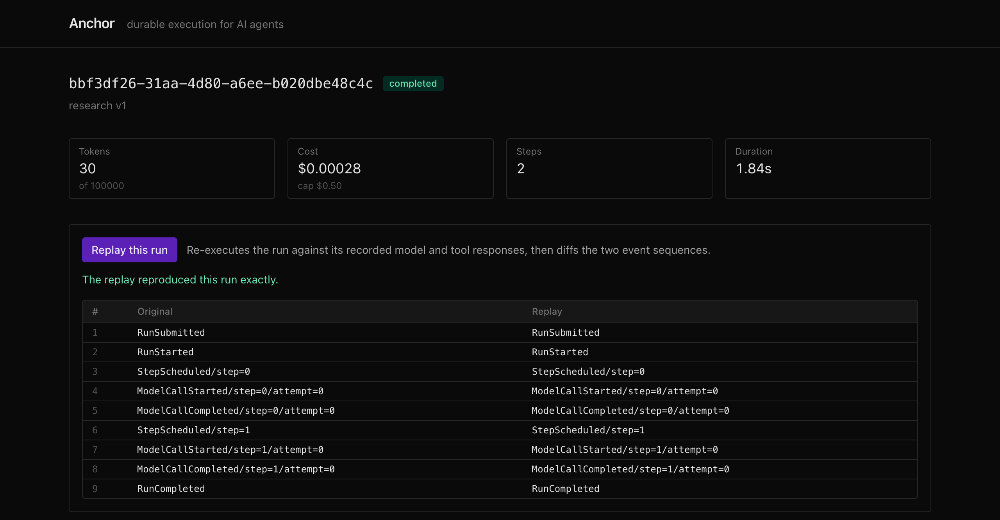
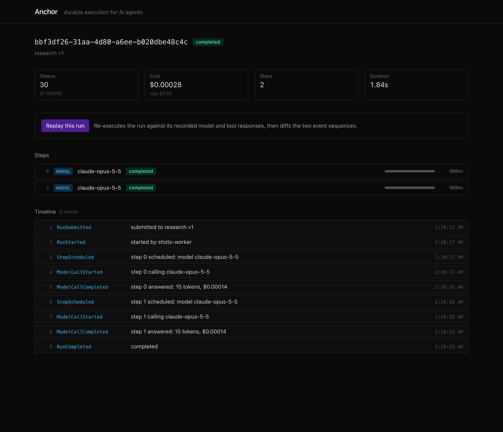
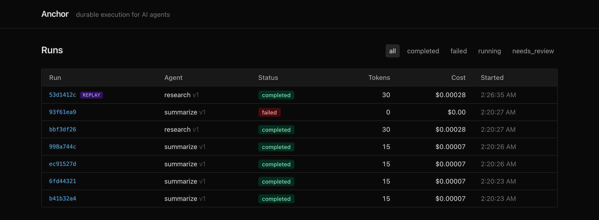

# Anchor

[](https://github.com/marlmelara/anchor/actions/workflows/ci.yml)

**A durable execution runtime for AI agents.**

An agent run is a long, expensive, failure-prone sequence of model calls and tool
calls. Most implementations hold that sequence in process memory: if the process
dies at step 14 of 20, the run is lost, the money spent on those 14 steps is
gone, and there is no record of what actually happened.

Anchor is the infrastructure layer that fixes this. It provides three guarantees:

- **Durability** — every step is journaled before its effect is applied. A killed
  worker loses no committed progress; another worker resumes the run mid-flight.
- **Determinism** — any completed run can be replayed against its recorded
  model and tool responses and will follow the identical path to the identical
  terminal state. Non-reproducible agent failures become debuggable traces.
- **Safety** — tool calls execute in resource-capped sandboxes; runs execute
  under token and cost budgets, per-tenant rate limits, and provider circuit
  breakers.

This is the durable-execution pattern popularised by Temporal, Restate and
Inngest, narrowed to agent workloads and implemented from scratch. Temporal
solves replay with workflow-code determinism and a history service; Anchor makes
three simplifications that a single-writer, short-lived agent workload allows —
declarative graphs instead of arbitrary code, one worker per run instead of
per-step parallelism, and a Postgres `SKIP LOCKED` queue instead of a
partitioned log.

---

## What it looks like

**The crash demo.** Twenty-four runs, three workers, and a `SIGKILL` landing on
a random worker every three seconds. Watch the pairs: every `!! kill -9` is
followed moments later by another worker reaping the dead one's lease and
carrying its run on from the next step. Twenty-four runs in, twenty-four runs
out, every effect applied exactly once.


Run it yourself with `make chaos`. It exits non-zero if a single run is lost or
a single effect is applied twice, so it is wired into CI as a test rather than
kept around as a demo.

---

The trace viewer ships with the runtime (`make viewer-dev`). It reads the event
log over SSE, so a running agent's timeline fills in live.

**Replay.** Any completed run can be re-executed against its recorded model and
tool responses. Anchor diffs the two event sequences position by position; an
identical sequence is the determinism guarantee holding, and a divergence shows
up as the first row where the two columns disagree.



**The event log.** `runs` and `steps` are projections folded from an append-only
`run_events` table. The log is the source of truth, and a database trigger
rejects any `UPDATE` or `DELETE` against it.



**Run list.** Token counts and dollar costs come off that same fold, not a
side-channel counter.



---

## Status

All eight milestones are complete. Runs are journaled, claimed from a
`SKIP LOCKED` queue, and executed by a worker pool against a mock provider,
with idempotency keys and retries. Workers that are `SIGKILL`ed lose no runs
and duplicate no effects — proven by a chaos suite that kills real processes:

```bash
make chaos
```

Tool calls run in resource-capped Docker containers, and the real Anthropic
adapter sits behind the same interface as the mock:

```bash
make live-check          # one real run against the Anthropic API
make chaos               # kill workers, prove no runs are lost
go run ./cmd/anchorctl fidelity   # replay a corpus and report fidelity
make viewer-dev          # the trace viewer at localhost:3000
make bench               # the benchmark sweep
```

**The demo to watch first** is the crash demo: kill a worker on camera and
watch another pick the run up at the exact next step. Script in
[`docs/DEMO.md`](docs/DEMO.md).

See [Milestones](#milestones).

---

## Quickstart

Requires Go 1.27+ and Docker.

```bash
make up        # start Postgres and Redis, wait for health
make migrate   # apply the schema
make test      # run everything, including the database tests
make ci        # run exactly what CI runs, before you push
```

Run it:

```bash
go run ./cmd/anchor-server &
go run ./cmd/anchor-worker -pool 4 &
```

Register an agent and submit a run:

```bash
curl -sX POST localhost:8080/v1/agents -d '{
  "name": "two-step",
  "graph": {"agent":"two-step","v":1,"nodes":[
    {"id":"n1","type":"model_call","model":"mock","prompt":"Answer: {{input.topic}}"},
    {"id":"n2","type":"tool_call","tool":"echo","input":{"said":"{{n1.output}}"}}
  ]}
}'

curl -sX POST localhost:8080/v1/runs -d '{"agent":"two-step","input":{"topic":"durable execution"}}'
curl -s localhost:8080/v1/runs/<run-id>
```

Or drive it from the CLI:

```bash
go run ./cmd/anchorctl submit -agent two-step -input '{"topic":"durable execution"}'
go run ./cmd/anchorctl show -run <run-id>
```

Prove the projections are derivable from the log:

```bash
make verify    # recompute from run_events and report any disagreement
```

Anchor's containers bind host ports **5433** (Postgres) and **6380** (Redis) so
they can run alongside another project's database. Override with `make DSN=...`.

---

## Architecture

```
CLIENTS
  [ TypeScript SDK ]  [ Trace Viewer (Next.js) ]
        | submit / cancel / replay        | reads journal
        v                                 |
CONTROL PLANE
  [ anchor-server (Go) ]
     REST API + SSE streaming
        | enqueue
        v
STATE
  [ PostgreSQL ]
     run_events  (append-only, source of truth)
     runs / steps / leases  (projections)
     queue       (claimed via SKIP LOCKED)
        ^
        | claim / heartbeat / journal
EXECUTION
  [ anchor-worker pool (Go) ]
     |--> LLM providers (HTTP)
     |--> Docker sandbox (one container per tool call)
     |--> Redis (rate-limit buckets, breaker state)
     |--> Prometheus (/metrics)
```

| Component | Language | Owns |
|---|---|---|
| `anchor-server` | Go | HTTP API, SSE streaming, validation, enqueue. Stateless. |
| `anchor-worker` | Go | Claim runs via lease, fold journal, execute steps, journal results, heartbeat, retries, graceful drain. |
| `anchor-sandbox` | Go | Docker API wrapper: one container per tool call, with limits, always removed. Orphans reaped on worker start. |
| `trace-viewer` | TypeScript / Next.js | Read-only UI over the journal: run list, DAG, step detail, replay trigger. |
| `sdk` | TypeScript | `defineAgent()`, `defineTool()`, `submitRun()`, `streamRun()`. |

### How state works

`run_events` is the only authoritative record. `runs` and `steps` are
projections, written in the same transaction as the event that implies them and
rebuildable from the log alone:

```bash
go run ./cmd/anchorctl rebuild          # recompute
go run ./cmd/anchorctl rebuild -verify  # report drift without repairing it
```

CI runs `rebuild -verify` after the full test suite. Projection drift is a build
failure, not a warning — it means the append path and the fold have disagreed,
and one of them is wrong.

### How concurrency works

`UNIQUE (run_id, seq)` is the entire concurrency control. Two workers that both
believe they own a run fold the same log, compute the same next `seq`, and race
to insert. Postgres picks a winner; the loser's transaction aborts and it
releases the run. There is no distributed lock, and the guard sits on the write
itself rather than on the intent to write, so it holds even when the lease logic
is wrong.

### How replay works

Every source of non-determinism is captured at record time and injected at
replay time:

| Source | Recorded as | Injected on replay |
|---|---|---|
| LLM completion | `ModelCallCompleted.payload.response` | returned instead of calling the provider |
| Tool output | `ToolCallCompleted.payload.{output, exit_code}` | returned instead of running the container |
| Current time | every event's `created_at` | `RunState.Now()` returns the recorded timestamp |
| Random values | `StepScheduled.payload.rand_seed` | the same seed reseeds the generator |
| Retry timing | `RetryScheduled.payload.delay_ms` | the delay is skipped, the sequence preserved |
| Go map order | forbidden | never iterate a map to drive control flow |

---

## Design decisions

Every decision that had a real alternative is written up in
[`docs/decisions.md`](docs/decisions.md), with the alternative and what the
choice costs.

---

## Milestones

| # | Deliverable | Status |
|---|---|---|
| M1 | Repo, Docker Compose, CI. Schema and migrations. Event append with `(run_id, seq)` uniqueness. Fold. `rebuild` command. Unit tests on the fold. | **done** |
| M2 | `anchor-server` REST API. `SKIP LOCKED` queue. Worker pool claiming and executing a two-node graph. Idempotency keys enforced. Retries with backoff. | **done** |
| M3 | Lease expiry takeover and the reaper. Chaos script. Crash recovery proven. | **done** |
| M4 | Docker sandbox executor with limits; tool schema validation; real LLM provider adapter. | **done** |
| M5 | Budgets, Redis token-bucket rate limiting, circuit breaker, backpressure. Prometheus metrics. | **done** |
| M6 | Deterministic replay end-to-end: `ReplaySource`, replay run type, divergence detection, fidelity report. | **done** |
| M7 | Trace viewer. TypeScript SDK. | **done** |
| M8 | k6 load tests, chaos suite in CI, measured benchmarks, demo video. | **done** |

---

## Benchmarks

Measured on an Apple M2 laptop, 8 cores, against a **mock provider at fixed
latency** so the figures describe Anchor rather than a model. Full methodology,
commands and honesty notes in [`docs/NUMBERS.md`](docs/NUMBERS.md).

```bash
make bench        # reproduce these
```

| Measurement | Steady (50/s) | Saturated (400/s) |
|---|---|---|
| Runs submitted / completed | 1501 / **1501** | 7968 / **7968** |
| Throughput | 100 steps/sec | **199 steps/sec** |
| Scheduling latency (claim → first step) | p99 **50 ms** | p99 **50 ms** |
| Queue wait (submit → claim) | p99 250 ms | p50 **30 s** |
| Drain after load stopped | 0 s | 60 s |

At **eight times** the sustainable rate nothing is lost — the system queues.
And the two latencies move completely differently: scheduling latency is flat,
queue wait explodes. Everything that backs up, backs up *before* the claim,
which is why they are separate metrics. One averaged "latency" number would
have hidden both facts.

| Durability | Result |
|---|---|
| Duplicate effects under fault injection | **zero** (7+ `SIGKILL`s, 5 resumptions) |
| Runs lost under fault injection | **zero** |
| Runs stranded by a rolling restart | **zero** |
| Replay fidelity | **100%** over 200 runs |

Quantiles are Prometheus bucket upper bounds, the hardware is a laptop running
everything at once, and both caveats are stated in `NUMBERS.md` rather than
left for the reader to discover.

## Scope

Deliberately **out** of scope: multi-region replication, distributed consensus,
a visual workflow builder, multi-tenancy beyond a `tenant_id` column and
per-tenant limits, autoscaling, model fine-tuning or RAG, and auth beyond a
static per-tenant API key. Anchor runs agents; it is not an agent.
